+++
title = "御船印の思い出1冊目"
description = "フェリーに乗ったりしたときに購入できる御朱印の船バージョンである御船印、その1冊目が埋まったのでメモしておきます"
date = "2026-10-07T23:30:00+0900"
draft = false
+++

フェリーに乗ったりしたときに購入できる御朱印の船バージョンである御船印、その1冊目が埋まったのでメモしておきます。

## 軌跡

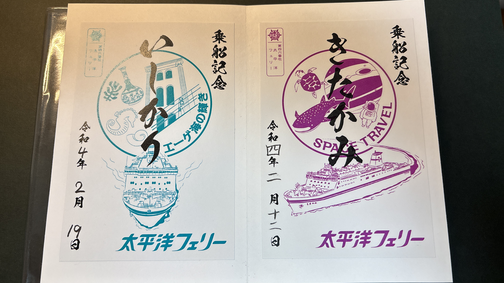

- 2022-02-12 / 太平洋フェリー（第46番社） / きたかみ（SPACE TRAVEL）
- 2022-02-19 / 太平洋フェリー（第46番社） / いしかり（エーゲ海の輝き）

だいぶ記憶が薄いのですが、どうやら北海道にまで行ったらしいです。ラッキーピエロとかの写真もありました。

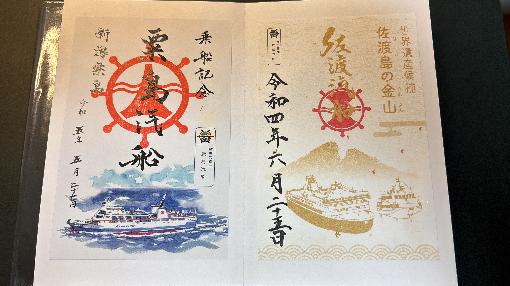

- 2022-06-25 / 佐渡汽船（第15番社） / 佐渡汽船（世界遺産候補 佐渡島の金山）
- 2023-05-26 / 粟島汽船（第50番社） / 粟島汽船（新潟 粟島）

佐渡と粟島、両方新潟の離島ですね。粟島では馬に乗りましたね。懐かしい。

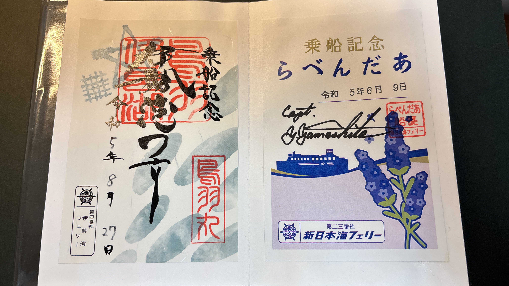

- 2023-06-09 / 新日本海フェリー（第23番社） / らべんだあ
- 2023-08-27 / 伊勢湾フェリー（第4番社） / 伊勢湾フェリー 鳥羽丸

小樽に行ったのと渥美半島から鳥羽まで渡ったやつですね。伊勢湾フェリーは乗り場までが遠かった...

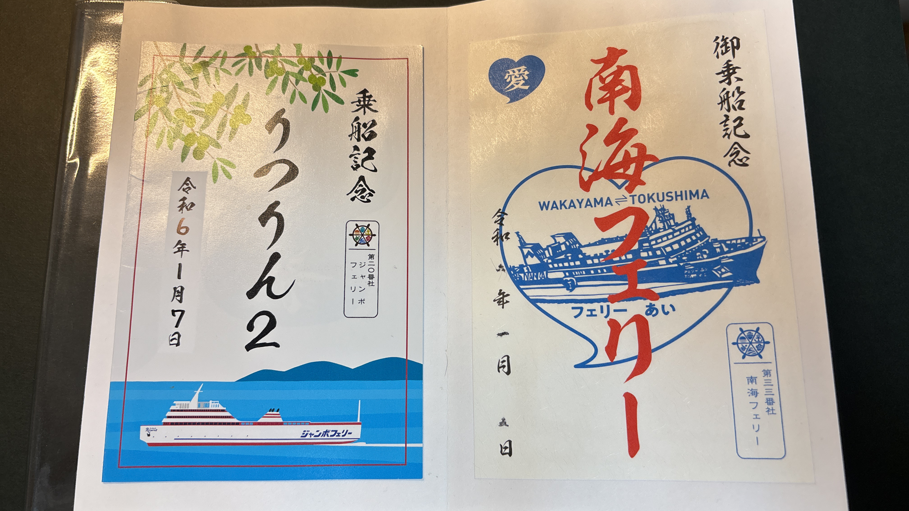

- 2024-01-05 / 南海フェリー（第33番社） / 南海フェリー（WAKAYAMA ⇄ TOKUSHIMA）
- 2024-01-07 / ジャンボフェリー（第20番社） / りつりん2

和歌山から徳島へ渡って、高松から神戸へ渡ったやつですね。ラーメン東大おいしかった :ramen:

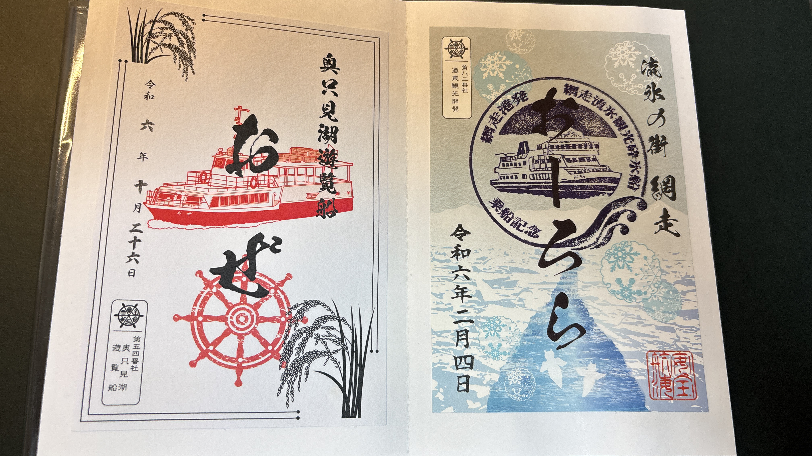

- 2024-02-04 / 道東観光開発（第82番社） / おーろら（網走流氷観光砕氷船）
- 2024-10-26 / 奥只見湖遊覧船（第54番社） / おぜ

砕氷船が最高でしたね。まだこの頃はブーツ履いてて吸水性能抜群で危うく凍傷になるところでした...

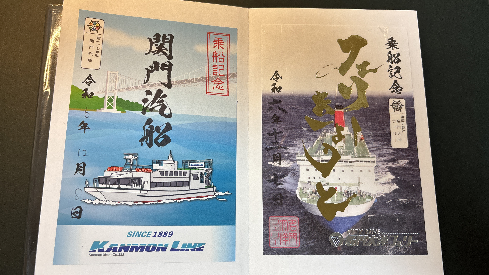

- 2024-12-07 / 名門大洋フェリー（第45番社） / フェリーきょうと
- 2024-12-08 / 関門汽船（第127番社） / 関門汽船

北九州へ行った時のですね、新門司港近辺は船が多くて羨ましいなあ...

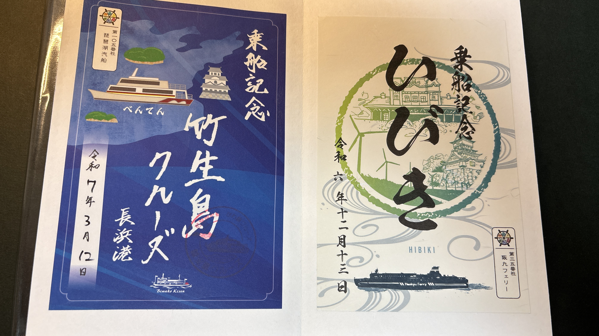

- 2024-12-13 / 阪九フェリー（第35番社） / ひびき
- 2025-03-12 / 琵琶湖汽船（第105番社） / 竹生島クルーズ 長浜港（べんてん）

北九州からの帰りと、ずっと気になってた琵琶湖の船ですね。

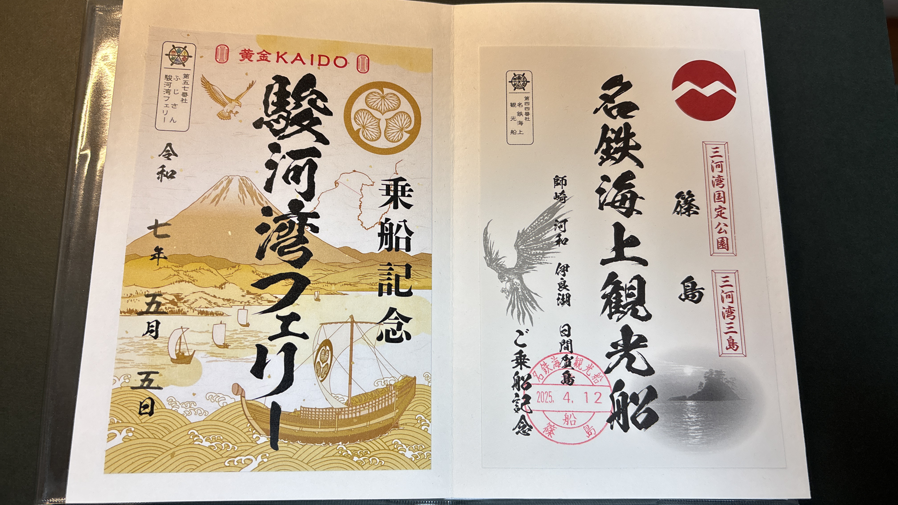

- 2025-04-12 / 名鉄海上観光船（第44番社） / 篠島（三河湾三島）
- 2025-05-05 / ふじさん駿河湾フェリー（第57番社） / 駿河湾フェリー（黄金KAIDO）

それぞれ単発で篠島と駿河湾。後者のは黄金のフェリーからの富士山の景色は綺麗でしたね。

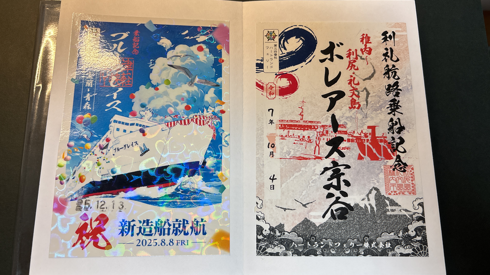

- 2025-10-04 / ハートランドフェリー（第34番社） / ボレアース宗谷（稚内〜利尻・礼文島）
- 2025-12-13 / 津軽海峡フェリー（第128番社） / ブルーグレイス（室蘭・青森、新造船就航 2025.8.8）

稚内へ行ったときのフェリーと、室蘭から青森へ渡ったときの船ですね。後者は時間的になかなかハードモードでしたw

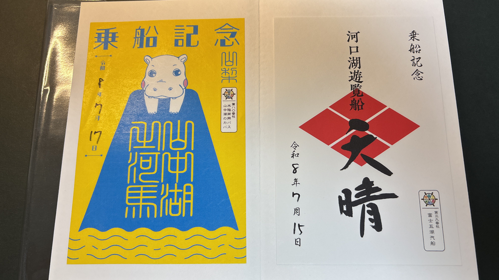

- 2026-07-15 / 富士五湖汽船（第39番社） / 河口湖遊覧船 天晴
- 2026-07-17 / 山中湖のカバ（第80番社） / 山中湖のカバ（水陸両用バス）

ここまでくるとつい最近です。これらはついでですが河口湖と山中湖で軽く乗ってきました。

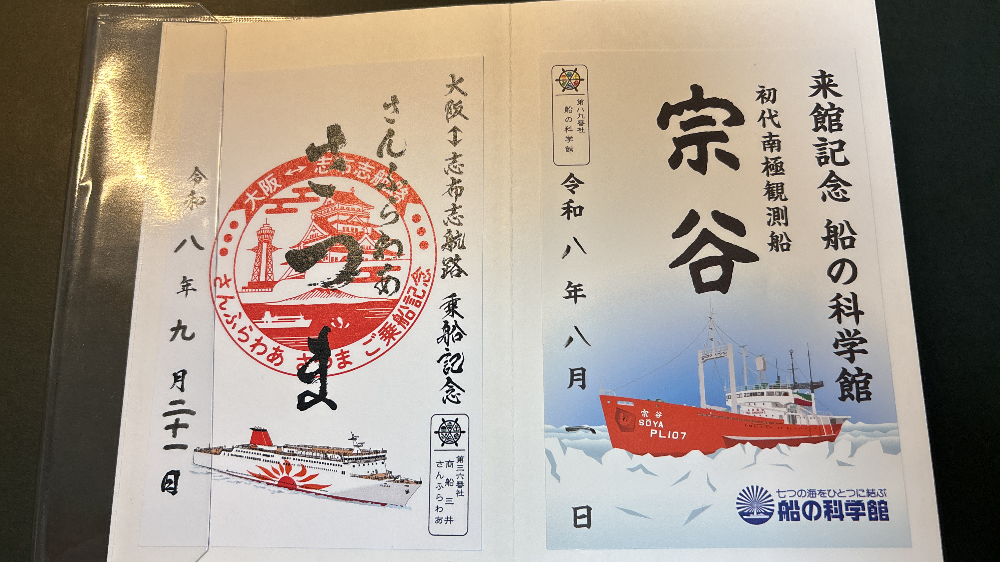

- 2026-08-01 / 船の科学館（第89番社） / 宗谷（初代南極観測船、来館記念）
- 2026-09-21 / 商船三井さんふらわあ（第36番社） / さんふらわあ さつま（大阪↔志布志航路）

東京行ったついでにゲットしたのと、2024年末以来の長距離フェリーで大阪・志布志のさんふらわあですね。これは良かった...！

## 次の冊子

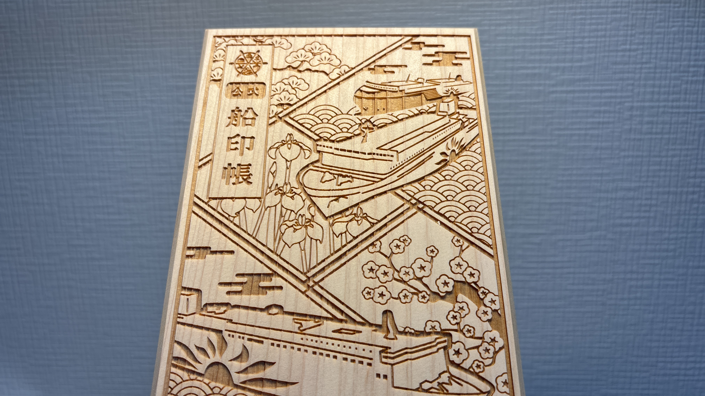

ということで、一番最後に掲載してあったさんふらわあで、2冊目の冊子を買いました。

公式だけどさんふらわあ限定の船印帳（ひのき）です。
ぎりぎりまで迷ってたんですけど、やっぱり目の前にするとひのきいいですよ...。

## 達成: 21社

御船印のカウント的にはフェリーの種類ではなく番社数なので、
結局いくつ回ったのかをカウントしてみたところ、特に大きくかぶらずに21社まで達成してたみたいです。

- 第4番社 伊勢湾フェリー
- 第15番社 佐渡汽船
- 第20番社 ジャンボフェリー
- 第23番社 新日本海フェリー
- 第33番社 南海フェリー
- 第34番社 ハートランドフェリー
- 第35番社 阪九フェリー
- 第36番社 商船三井さんふらわあ
- 第39番社 富士五湖汽船
- 第44番社 名鉄海上観光船
- 第45番社 名門大洋フェリー
- 第46番社 太平洋フェリー
- 第50番社 粟島汽船
- 第54番社 奥只見湖遊覧船
- 第57番社 ふじさん駿河湾フェリー
- 第80番社 水陸両用バス 山中湖のカバ
- 第82番社 道東観光開発
- 第89番社 船の科学館
- 第105番社 琵琶湖汽船
- 第127番社 関門汽船
- 第128番社 津軽海峡フェリー

全然急がずにゆっくりやっていこう。

やっぱ御船印いいな、見るだけで思い出に浸れる...
