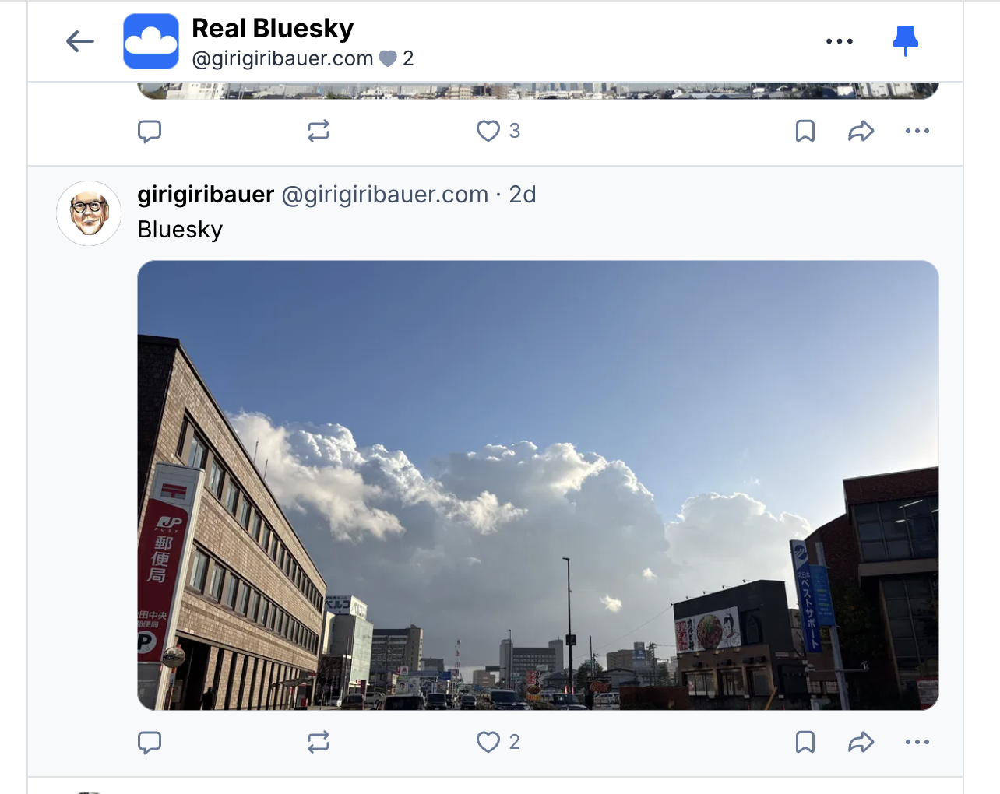
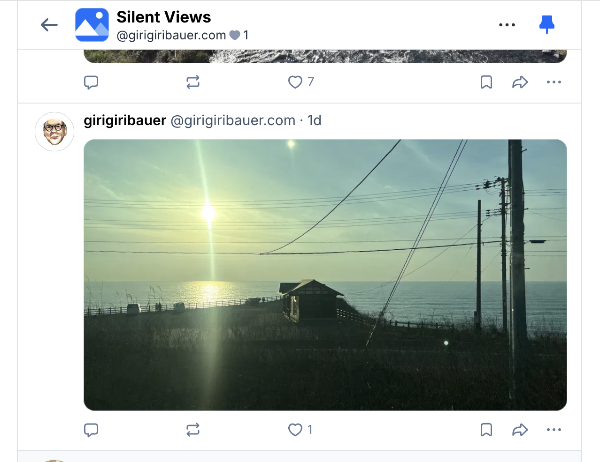
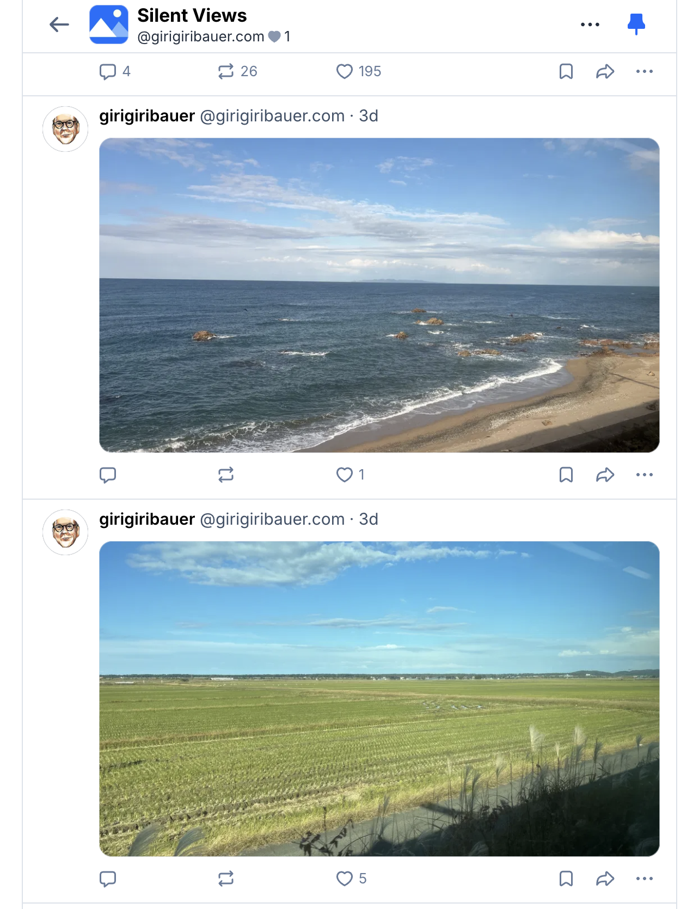

+++
title = "言葉のない風景写真だけが流れる Bluesky フィード Silent Views の仕組み"
description = "軽量なフィルターをたくさん並べるだけで風景写真だけがなぜか残るフィードの仕組みの詳細をメモしておきます"
date = "2026-11-17T08:00:00+0900"
draft = false
tags = ["Bluesky", "SNS", "Rust"]
+++

**Silent Views** という Bluesky のフィードを作りました。

https://bsky.app/profile/girigiribauer.com/feed/silentviews

本文に言葉がなく画像だけの投稿のうち、 **静かな景色の写真だけ** が流れてくるフィードです。日本に限らず、 **世界中の投稿が対象** です。

どういう仕組みで動いているのかを、忘れないうちにメモしておきます。なお、リリース後も改善が続いているので、主にリリース時点の話としておきます。

## 作ろうと思ったきっかけ

前身として **Real Bluesky** 、 **Fake Bluesky** というフィードを作っていて、こちらはシンプルに青い画素を判定しているだけなのですが、思ったより高い精度で青空の画像を即時に判定できていました。

リアルタイムなんですよ、 AI も使ってないんですよ、すごくないですか？

その応用として **「除外する小さなフィルター」をいくつも重ねていけば、綺麗な風景の画像だけを抽出できるのではないか？** という仮説を立てて、それを実際に検証してみたのがこの **Silent Views フィード** です。

## どういうフィードにしたいか？

一番の軸は **安心して見られること** で、流れてくる量よりも、意図しないものが目に入らないことを優先しています。

具体的な中身はこう決めました。

- センシティブな画像はダメ
- 人間は入れない
- 絵、イラスト、文字は入れない
- おなじく AI 生成の風景は入れたくない（とはいえ機械的に弾くのは限度がある）
- 花や葉っぱ、キノコなどの大写しは入れない（≒ **少し遠景であること** ）
- 自然の割合が大きければ、建物が少し写っていてもよい
- 小さく目立たず写り込んだ物は、主役が景色なら通してよい
- 動物は小さく写っているぶんにはよい

ちなみに、本文に言葉がない投稿だけを対象にしているのも **安心して見られること** のためです。世界中の投稿が対象なので、本文があると読めない言語や意図しない考えや思想が目に入ってしまいます。なので、 **空文字か記号や絵文字が3つ以内の本当に静かな投稿のみを対象** にしています。

### メモリ 1GB の VPS で動くこと

もう1つ、別の視点での条件があります。このフィードは他の Bluesky サービスと同様、さくらの VPS のメモリ 1GB の貧弱サーバーで動かしています。（いまどき 1GB のメモリで何できんの？って言われそうですが...）

ちなみに最初に作った試作は、判定を流すと **最大で約760MB** 使っていました。もうこれだけでメモリ食い潰してしまいますやん。これはさすがに動かせないので、色々 Rust 上で最適化しました。

全体に効いたのは次の3つです。

- 重い画像判定のモデルは、軽いものに替えるか別のモデルで代用した
    - 1つで 100MB を超えるものがいくつもあった（詳しくは後半のそれぞれの所で）
- 画像判定のモデルは使うときだけ読み込む
- Linux のメモリ確保の設定を変えた
    - 大きめのメモリは OS から直接借りる設定にしたところ、投稿の合間のメモリが 86MB から 27MB に減った

結果、 **最大でも約76MB、何もないときは約19MB** に収まりました。10分の1です！わー🎉

当然ですが、画像を見せて「これは風景ですか？」と聞けば答えてくれるような、いわゆる **生成 AI には判定させていません。** この VPS の中で動かすのは当然無理ですし、外のサービスに画像を投げて聞く、ということもしていません。全部ローカルでリアルタイムに動いています。

## 軽量なフィルターをたくさん用意する

きっかけの所で書いたとおり、小さなフィルターをいくつも重ねる作りにしています。

- すべてのフィルターは **当てはまれば弾くだけ** にする
- 生成 AI や重い処理には頼らず、 **軽い判定の掛け合わせ** で絞る
- うまく境界線が引けないときは、弾く側に倒す

フィルターは全部で23種類（2026/11/10 公開時）あって、どれか1つにでも当てはまったらそこで打ち切って弾きます。全部通り抜けた投稿だけがフィードに載ります。

本番を動かしはじめた時点で、1時間に2,000〜2,400件ほどを判定して、通るのは4〜6件でした。そもそも言葉のない画像付き投稿というのは、文字入りのミーム、スクリーンショット、人物あたりが大半で、自然の写真は1%前後しかありません。

### 使っているモデル

使っている学習済みモデルは次の5つで、どれも小さいものです。

- **TinyCLIP** : 画像と言葉がどれくらい近いかを測る
- **PP-OCRv3** : 画像の中から文字のありかを探す
- **PP-OCRv4** : 見つけた場所の文字を実際に読む
- **NanoDet** : 人・犬・車など80種類の物を探す
- **U²-Net（軽量版）** : 写真の中で目立つ物を切り出す

モデルを使わないフィルターは、色や明るさを数えるだけの自前の計算です。

この中で一番よく使っているのが **TinyCLIP** です。 CLIP というモデルを小さくしたもので、 CLIP はざっくり言うと、 **画像と言葉がどれくらい近いかを測れるモデル** ですね。言葉の組を2つ用意して、画像がどちらの組に寄っているかを0〜1の数字で出す、という使い方をしています。

いやあこれ最初に CLIP を試したときは驚きました。
**要は「犬」とか「車の中から撮った写真」とか、こちらが好きな言葉を渡すだけで、それ用の判定器がその場でできあがる** 、みたいなものをイメージしてもらえれば良いと思います。もちろん 100% 弾くものではないものの、こういう多段フィルターの仕組みで使うにはまさにもってこいの学習済みモデルです。

https://github.com/openai/CLIP

CLIP は「画像を数字の並びにする」ところが重くて、「どの言葉と比べるか」は軽いです。つまり **画像を1回数字にしてしまえば、言葉の組を替えるだけで物差しを何本でも作れます。** 言葉の側も事前に数字にしてファイルに保存してあるので、本番で動いているのは画像側のモデルだけです。

最初は MobileCLIP というモデルを使っていたのですが、メモリを約138MB 使っていたのと、研究目的向けのライセンスで公開するフィードには使えなかったので、 TinyCLIP に替えました。

## 画像を見る前に落とす条件

まず画像をダウンロードする前に、投稿のデータだけで落とせるものを落とします。

- **本文に言葉がないこと**
    - 言語を問わず、文字や数字が1つでもあれば対象外
    - 絵文字や記号だけなら **3個まで** は可（4個以上は「喋っている」とみなす）
- **返信、引用ではないこと**
    - 返信先や引用先の本文が一緒に表示されてしまうため
- **画像だけであること**
    - 動画やリンクカード付きは対象外
- **投稿者自身が警告ラベル（アダルトなど）を付けていないこと**

逆に、 **ALT （画像の説明文）付きの投稿は残しています。** ALT は普通に眺めているぶんには目に入らないですし、目の不自由な人にとっては ALT 付きの投稿だけが中身の分かる投稿になるので、そこを外してしまうとフィードの意義がなくなってしまいます。

例外として `#silentviews` というタグだけが書かれた投稿は候補にしています。このフィードに載せたい人向けの入り口です。

## フィルターごとの詳細（23種類・適用順）

ここからは、23種類のフィルターを実際に適用される順番で1つずつ書いていきます。

軽くて安いものを前に、重いものを後ろに並べています。重い判定ほど、動かす回数が少なくて済むようになっています。

- **画像を見る前** : 投稿のデータだけを見る
- **1段目** : 128px の小さい画像を見る（フィルター3種類）
    - [1. 平らな塗り小フィルター](#filter01)
    - [2. 色数が少ないフィルター](#filter02)
    - [3. 自然の色が少ないフィルター](#filter03)
- **2段目** : 長辺1000px の大きい画像を見る（フィルター17種類）
    - [4. 縦横比が極端フィルター](#filter04)
    - [5. 平らな塗り大フィルター](#filter05)
    - [6. 文字の模様フィルター](#filter06)
    - [7. 近景の塊フィルター](#filter07)
    - [8. 真ん中の主役フィルター](#filter08)
    - [9. 左右対称フィルター](#filter09)
    - [10. 模様なしフィルター](#filter10)
    - [11. 物フィルター](#filter11)
    - [12. 人フィルター](#filter12)
    - [13. 生き物フィルター](#filter13)
    - [14. 人工物の場面フィルター](#filter14)
    - [15. アップ・見下ろしフィルター](#filter15)
    - [16. 窓ごしフィルター](#filter16)
    - [17. 文字（OCR）フィルター](#filter17)
    - [18. 端の文字フィルター](#filter18)
    - [19. 模様が粗いフィルター](#filter19)
    - [20. 線が多いフィルター](#filter20)
- **3段目** : 画像を3×3のマスに分けて見る（フィルター2種類）
    - [21. マスのアニメ調フィルター](#filter21)
    - [22. マスの人フィルター](#filter22)
- **4段目** : 手前にある目立つ物を見る（フィルター1種類）
    - [23. 手前の物フィルター](#filter23)

ちなみに、画像が複数枚ある投稿は、 **全部の画像が全部の段を通ったときだけ** 載せます。1枚でも弾かれたら投稿ごと落としています。

### 1. 平らな塗り小フィルター {#filter01}

小さい画像を細かい区画に分けて、 **色の変化がまったくない「平らな塗り」** がどれくらいあるかを見ます。これが多ければ弾きます。

イラストを落とすためのものです。写真はどんなになめらかに見えても、隣り合う画素が完全に同じ色になることはまずありません。完全に同じ色が広く続いていたら、それはデジタルで塗ったものです。

### 2. 色数が少ないフィルター {#filter02}

よく使われている上位5色が、画面のどれくらいを占めているかを見ます。 **4割以上** なら弾きます。

色数の少ないベタ塗りの画像を落とすためのものです。

### 3. 自然の色が少ないフィルター {#filter03}

緑・青・土の色の画素を数えて、合計が画面の **4分の1未満** なら弾きます。

単純ですが、手元で確かめたとき（10月時点）は、小さい画像での判定だけで約7割が落ちました。この3つの **本当の目的はダウンロード量を減らすこと** です。大きい画像の判定自体はそこまで重くないのですが、画像を取ってくる通信がもったいないので、小さい画像で明らかに違うものを先にふるい落としています。

弱点もあって、夕焼けや紅葉のようなオレンジや赤は「自然の色」に数えていないので、良い風景がここで落ちることがあります。前ふるいとしての役目が大きいので、今はそのままにしています。

### 4. 縦横比が極端フィルター {#filter04}

ここからは大きい画像を取ってきての判定です。

縦横比が **3倍以上** の、極端に横長・縦長の画像を弾きます。投稿のデータに縦横比が書いてあれば画像を取る前に落とせるのですが、書いていない投稿もあるので、画像を開いてからもう一度見ています。

### 5. 平らな塗り大フィルター {#filter05}

1番と同じ「平らな塗り」を、今度は大きい画像で測り直します。

ここでハマったのが空で、青空や白い雲は平らなので、そのまま測ると綺麗な風景がイラスト扱いになってしまいます。かといって空をまるごと無視すると、今度は描かれた空のグラデーションがすり抜けます。

結局、「そのまま測った平らさ」と「空らしい部分を除いて測った平らさ」の **両方が高いときだけ弾く** 、という形に落ち着いています。

### 6. 文字の模様フィルター {#filter06}

背景との明暗の差が大きい、細い横長の帯（文字の行のような形）を探して、その広さを見ます。画面の1%ちょっとを超えたら弾きます。

モデルを使わないコストの低い文字探しです。先に簡易的なものを落として、詳しく見ないと分からないものは後ほど別のフィルターで見ていきます。

### 7. 近景の塊フィルター {#filter07}

画面を細かいマス目に分けて、マスごとに「空」「遠景」「近景」のどれかに分類します。

- 上の端からつながっている、なめらかで空の色のマス -> 空
- 細かい模様が多いマス -> 遠景（遠くの森や山は細かい模様になる）
- それ以外ののっぺりしたマス -> 近景（手前の物、人の肌など）

そのうえで、 **近景の大きな塊** が画面の3分の1ほどを占めていたら弾きます。人の体によく効きます。

ただし湖面や海のような、なめらかな面が広い風景を巻き込んでいたので、空がほとんど写っておらず、なめらかな面も少ないときだけ弾くようにしています。

### 8. 真ん中の主役フィルター {#filter08}

7番と同じマス目の分類を使って、 **真ん中にだけ近景が集まっている** 画像を弾きます。

真ん中に主役（人や物）がいる構図は、風景ではないからです。真ん中を人が歩いている写真などがここで落ちます。

### 9. 左右対称フィルター {#filter09}

画像を左右に裏返したものと、どれくらい似ているかを見ます。似すぎていたら弾きます。

左右対称すぎる画像は、ロゴやデザイン画、 AI 画像などの作り物が多いためです。空から地面にかけての上下の明るさの変化は、どんな風景にもあるので、先に消してから比べています。

### 10. 模様なしフィルター {#filter10}

輪郭（はっきりした境目）がほとんどない、一色に近い画像を弾きます。

これは何度も出たり入ったりしたフィルターです。最初は曇り空や海ばかり弾いてしまって一度やめ、「ほぼ完全に一色」のときだけに絞って復活させ、それでも雲だけの空や霧の湖を巻き込んでいたので、 **空が広く写っているときは弾かない** という条件を足しました。

空が写っているせいで誤解する、というのはこの後も何度か出てきます。

### 11. 物フィルター {#filter11}

ここから3つは、 NanoDet という80種類の物を探してくれる小さい学習済みモデルを使います。

はっきり物だと分かるもの（車や椅子など）が見つかったら弾きます。

ただこのモデル、風景の一部を鳥やキリン、ブロッコリーなどと見間違えることがよくあります。なので、そういう **見間違いで出やすい名前** は、よほど確からしくない限りは通すようにしています。

### 12. 人フィルター {#filter12}

人が見つかって、それが画面の **2%以上** を占めていたら弾きます。

センシティブな画像にはだいたい人が写っているので、物より厳しめにしています。

### 13. 生き物フィルター {#filter13}

生き物として見つかったものの広さを合計して、画面の **10%以上** なら弾きます。

近すぎる猫や犬、虫のアップを落とすためのものです。
このモデルはそこまで精度は高くないものの **生き物らしい形にはちゃんと反応する** ので、名前を信じずに「生き物っぽいものの広さ」だけを使っています。

### 14. 人工物の場面フィルター {#filter14}

ここから3つは先にも触れた CLIP というモデルを使っています。

「森・山・海・空など」の言葉の組と、「街・建物・道路・室内など」の言葉の組を用意して、画像が後者に寄っていたら弾きます。絵やイラスト、 AI 画像を表す言葉も、こちらの弾く側に入れています。

もともとは場所の種類を当てる専用のモデルを使っていたのですが、メモリを約167MB も使っていたので、 CLIP で代用しました。 CLIP はすでに他のフィルターで使っているので、 **専用のモデルを丸ごと1つ減らせた** ことになります。しかも CLIP のほうが、湖や渓流を巻き込まずに、電柱や歩道を弾けました。

### 15. アップ・見下ろしフィルター {#filter15}

「遠くまで写った風景」の言葉の組と、「アップ・地面の見下ろし・花壇」の言葉の組を比べて、後者に寄っていたら弾きます。

地面に咲いた花、花のアップ、真上から撮ったキノコのような写真を落とすためのものです。人が手入れした花壇や裏庭も一緒に止まります。

### 16. 窓ごしフィルター {#filter16}

「車の中から撮った写真」「フロントガラス越しの景色」といった言葉に寄っていたら弾きます。

車の窓ごしに撮った写真や、雨粒の付いた窓ごしの写真を落とすためのものです。

### 17. 文字（OCR）フィルター {#filter17}

ここから2つは文字のモデルを使います。

文字のありかを探すモデル（PP-OCRv3）で文字の塊を探し、横長の文字の列が1つでもあるか、文字の塊が3つ以上あれば弾きます。

ここは最初、探すモデルだけで判定していたのですが、 **地平線や木の枝の明暗まで「文字の塊」として拾ってしまう** 問題がありました🥺

そこで、見つけた枠を文字読みのモデル（PP-OCRv4）に渡して実際に読ませ、次のどちらかに当てはまる枠だけを文字として数えるようにしています。

- 読めた枠
- 読めないけど、字くらいの大きさの塊が一列に4つ以上並んでいる枠

後者は、手書きや崩した字を取りこぼさないためのものです。「読める」と「文字っぽい」は同じではない、というのがポイントでした。

この見直しでのメモリの増加は、 1MB 以内に収まっています。

### 18. 端の文字フィルター {#filter18}

17番で文字と数えた塊のうち、画面の上か下の端にまるごと収まっているものが1つでもあれば弾きます。

写真に後から重ねた短い見出しや、署名を拾うためのものです。景色の中の見間違いは、端にぴったり収まることがあまりないんですよね。

隅のごく小さいコピーライト表記などは見つけられませんが、全体が風景ならそれはよしとしています。

### 19. 模様が粗いフィルター {#filter19}

ここから2つは「近すぎる」写真を弾くためのもので、一番悩んだ所です。
奥行きを推定するモデルも試したのですが、「全部近い」と「全部遠い」の区別がつかなかったり、モデルを変換するための環境が大きすぎたりで、結局使えませんでした。

最終的には、 **遠くのものは模様が細かく、近くのものは模様が粗い** というところから解きました。

画像を強くぼかして、色と明るさが似た領域に分けます。その領域の中だけで、元の画像の模様の粗さを測ります。遠くの部分が1つもない、つまり **一番細かい領域でもまだ粗い** なら、近すぎる写真として弾きます。

ただ、空は遠くにあるのに細かい模様がないので、夕焼けや雲の写真まで「近すぎる」と判定してしまっていました🥺

なので、空が広く写っている写真はこのフィルターでは弾かないようにしています。

### 20. 線が多いフィルター {#filter20}

「近すぎる」の2つ目はこれです。

**遠景は細部がにじんで面に見え、近景は草が1本1本の線に見える**

19番で見つけた一番細かい領域の中に、細長い線分がどれくらい詰まっているかを数えます。詰まっていたら弾きます。芝生の上の枯れ葉や、クモの巣のような写真がこれで止まります。

### 21. マスのアニメ調フィルター {#filter21}

ここから2つは、画像を3×3のマスに分けて見ます。

写真全体を CLIP に見せても、小さく写っているものには気づいてくれません。そこで **マスごとに CLIP にかけて、どれか1つでも引っかかったら弾く** ということをしています。全体では判定できなくても、切り出した一部分でなら引っかかる、という考え方です。

マスは縦横それぞれ画像の半分の大きさで、4分の1ずつずらして並べています。こうしておくと、縦横4分の1までの大きさの物なら、どこにあってもどれかのマスにまるごと入ります。

21番で聞いているのは、アニメやゲームのキャラ、イラスト、 CG といった言葉です。景色の中に小さく写ったキャラクターグッズなどがここで落ちます。

良い写真も数枚巻き込まれるのですが、境界線が引けないときは弾く側に倒す、というルール通りにしています。

### 22. マスの人フィルター {#filter22}

21番と同じマスで、立っている人、ハイカーといったワードで判定します。

12番の物探しでは、本物の人と見間違いの区別がつかないような小さな人を拾うためのものです。尾根に立っている人などがここで落ちます。

マスの分だけ CLIP を9回動かすことになるので重く、だから21・22番は後ろに置いています。

### 23. 手前の物フィルター {#filter23}

最後は U²-Net という、写真の中で目立つ物を切り出してくれるモデルです。

景色の手前に物を置いて撮った写真、たとえばぬいぐるみを景色と一緒に撮った写真は、ここまでの判定をわりと通り抜けてきます。背景はちゃんと風景なので。

そこで、目立つ物として切り出された塊のうち、 **画面の下半分にあるもの** の広さを合計して、 **14%以上** なら弾きます。

- 上半分にかかる塊は、遠くの景色の一部とみなして数えない
- 横に長く平たい帯（水平線や波打ち際）は数えない
- 点のように小さい塊は数えない

小さく写り込んでいるだけなら通す、手前で大きく場所を取っているなら弾く、という線引きです。

## まとめ

といった感じで、23種類もの多段フィルターを実装しています。
それぞれはかなり軽量なので、フィードとして動かしてもそこまでメモリは食わないです。

で、実際どうなの？というところですが...

**けっこういい感じに静かな風景だけになってきてます！すごい！**

キャプチャで載せるのは自分の写真だけにしておくので、残りはご自身でご覧ください。感想なども聞かせてもらえると嬉しいです！

https://bsky.app/profile/girigiribauer.com/feed/silentviews

大部分は問題ないとはいえ、やはりまだまだ完璧だとは思ってなくて、このフィルターベースで弾く仕組みに加えて、やっぱりたぶんブラックリストみたいなものは必要そうで、この辺に追加する仕組みを自動化するのも今後の課題だと思ってます。

それにしても、やっぱり言語や地域問わず誰もが見られるフィードはいいなあ。もっと海外の人も含めて見てもらえると嬉しいんだけども。
